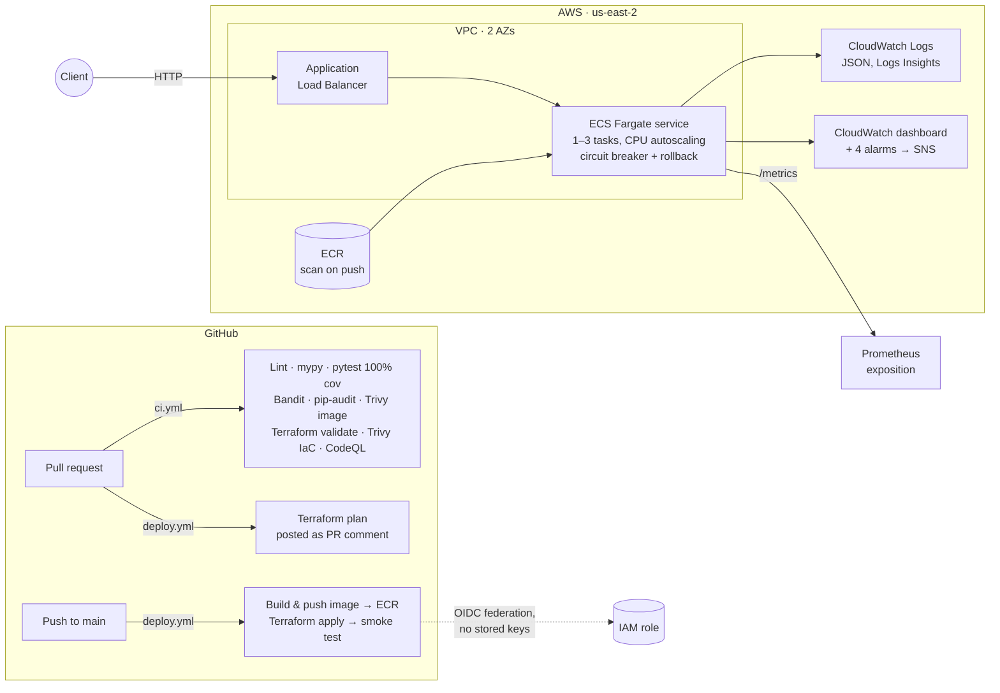

# Illustration Engine

[](https://github.com/femi-alla/illustration-engine/actions/workflows/ci.yml)
[](https://github.com/femi-alla/illustration-engine/actions/workflows/deploy.yml)
[](https://github.com/femi-alla/illustration-engine/actions/workflows/codeql.yml)
[](LICENSE)

An educational engineering demo: a small, production-shaped service that projects a
generic flexible-premium life insurance policy year by year under **guaranteed**,
**midpoint** and **current** assumptions, and the cloud platform that builds, ships,
runs and watches it.

The point of the project is to show two things side by side:

- **Insurance domain mechanics**, written as readable Python: premium loads, monthly
  expense charges, cost of insurance on the net amount at risk, fixed and indexed
  crediting with caps and floors, the death-benefit corridor, surrender charges and lapse.
- **Production-grade delivery**: a container on ECS Fargate (Graviton, ARM64) behind an
  application load balancer, all defined in Terraform, deployed from GitHub Actions with OIDC (no stored
  cloud keys), with tests, static analysis, image and IaC scanning, CloudWatch dashboards,
  alarms and structured logs.

> **Educational notice.** Every rate, charge, mortality curve and corridor factor in this
> repository is synthetic and was invented for teaching. The output is not an offer,
> quote or illustration of any real insurance product, and the project is not
> affiliated with any insurer.

---

## Architecture



The deployable unit is one container running a FastAPI application. Everything around it
exists to make that unit boring to operate.

---

## What the engine models

A flexible-premium policy is really a small bank account with an insurance charge taken
out of it every month. The engine processes the policy **monthly** (the way an
administration system would) and reports it **yearly** (the way an illustration does).

| Step | Plain-language description | Where |
|---|---|---|
| Premium load | A percentage of each premium is deducted before it reaches the account. | `ProductSpec.premium_load` |
| Expense charges | A flat monthly policy fee plus a per-$1,000-of-face charge for the first ten years. | `ProductSpec` |
| Net amount at risk | Death benefit minus account value: the part the insurer is actually on the hook for. | `engine.py` |
| Cost of insurance (COI) | Net amount at risk × a monthly mortality rate. The guaranteed scenario uses the full synthetic rate; the current scenario uses 60% of it; midpoint uses 80%. | `assumptions.annual_mortality_rate` |
| Interest crediting | **Fixed**: a declared rate credited monthly. **Indexed**: an assumed index return × participation, clamped between a floor and a cap, credited once per policy year. The guaranteed scenario always credits the contractual minimum; midpoint credits the average of guaranteed and current. | `CreditingAssumption` |
| Corridor | The death benefit is never less than the account value × an age-based factor, so an overfunded policy stays life insurance rather than becoming a savings account. | `assumptions.corridor_factor` |
| Surrender charge | A per-$1,000 charge that declines to zero over ten years; surrender value = account value − charge. | `ProductSpec.surrender_charge` |
| Lapse | If charges exhaust the account value, the policy lapses and the ledger stops with the lapse year recorded. | `engine.py` |
| Death-benefit options | **Level** pays the face amount; **increasing** pays face plus account value. | `IllustrationRequest` |
| Risk class | Preferred, standard and substandard scale the mortality rate (0.85×, 1.0×, 1.5×). | `RISK_CLASS_MULTIPLIER` |

The three scenarios follow the structure of a regulated illustration: *guaranteed* uses
maximum charges and minimum interest, *current* uses today's assumptions, and *midpoint*
averages both interest and charges.

**Deliberately not modelled** (each is a well-defined extension): policy loans and
withdrawals, riders, the 7702 definition-of-life-insurance and 7-pay (MEC) tests,
monthly premium modes, persistency bonuses, taxes, and any real mortality table.

### Sample output

```text
$ illustrate --age 35 --face 250000 --premium 3600 --years 30 --rate 0.06 --scenario current

CURRENT scenario  (credited 6.00%, COI factor 0.60)
 Yr  Age     Premium         COI    Interest    Acct Value    Surr Value     Death Ben
--------------------------------------------------------------------------------------
  1   36       3,600         198         189         3,129             0       250,000
  2   37       3,600         207         376         6,436             0       250,000
 10   45       3,600         311       2,314        40,618        39,868       250,000
 11   46       3,600         327       2,626        46,206        46,206       250,000
 20   55       3,600         468       6,431       113,359       113,359       250,000
 21   56       3,600         478       6,986       123,155       123,155       254,316
 30   65       3,600       1,521      13,473       237,272       237,272       428,038
```

Read down the table and the mechanics are visible: the surrender charge runs off after
year 10, and from year 21 the corridor starts lifting the death benefit above the face
amount as the account value grows.

---

## Using the service

```bash
curl -s -X POST http://localhost:8080/v1/illustrations \
  -H 'content-type: application/json' \
  -d @examples/indexed-increasing.json | jq '.scenarios.current.rows[-1]'
```

| Endpoint | Purpose |
|---|---|
| `POST /v1/illustrations` | Run the three-scenario projection. Request schema is validated with Pydantic; unknown fields are rejected. |
| `GET /v1/assumptions` | The synthetic charge structure, mortality curve and corridor factors in use, so any ledger can be audited by hand. |
| `GET /docs` | Interactive OpenAPI documentation. |
| `GET /healthz` · `GET /readyz` | Liveness, and readiness that actually runs a projection. |
| `GET /metrics` | Prometheus exposition: request counts and latency histograms by route, illustrations by crediting kind. |
| `GET /version` | Package version and the git SHA baked in at build time. |

Every response carries an `x-request-id` header (echoed if supplied), and every request is
logged as one JSON line with method, route template, status and duration, which the
CloudWatch dashboard queries directly.

### Local development

```bash
python -m venv .venv && . .venv/bin/activate     # Windows: .venv\Scripts\activate
make install                                     # pip install -e ".[dev]"
make lint typecheck test security                # ruff, mypy --strict, pytest (90% gate), bandit, pip-audit
make run                                         # uvicorn with reload on :8080
make docker-build docker-run
```

---

## Infrastructure

Two Terraform stacks, split by lifecycle:

| Stack | Applied by | Contains |
|---|---|---|
| `infra/bootstrap` | A person, once | S3 state bucket (versioned, encrypted, native locking), ECR repository (immutable tags, scan on push, keep last 10), GitHub OIDC provider and the IAM deploy role with a service-scoped policy. |
| `infra/live` | GitHub Actions on every push to `main` | VPC with two public subnets, security groups, ALB + target group with `/healthz` checks, ECS cluster (Container Insights) and Fargate service on Graviton (ARM64), task execution and task roles, CPU target-tracking autoscaling (1–3 tasks), deployment circuit breaker with rollback, CloudWatch log group, dashboard, four alarms and an SNS topic. |

The deploy role's trust policy only accepts tokens whose subject carries this
repository's immutable owner and repository ids (`repo:owner@id/name@id:...`, the form
GitHub now issues) for the `main` branch, pull requests and environments, so neither a
fork nor a renamed or re-created repository can assume it.

### Trade-offs made on purpose

These are documented in code comments and accepted in `.trivyignore` with reasons.

- **No NAT gateway.** Tasks run in public subnets with public IPs so they can reach ECR
  and CloudWatch; the task security group still only admits the load balancer. A NAT
  gateway would add roughly $35/month per AZ to a demo. Production would use private
  subnets with NAT or VPC endpoints.
- **Plain HTTP on the load balancer.** A TLS listener needs a domain and an ACM
  certificate; a throwaway demo has neither.
- **Service-scoped rather than resource-scoped IAM** for the deploy role, so the stack
  can evolve without a policy change each time. IAM writes are limited to this project's
  role name prefix and S3 to the state bucket.
- **Graviton (ARM64) Fargate.** The task definition sets `cpu_architecture = "ARM64"`
  and CI builds the image for `linux/arm64` on a native ARM runner. Fargate bills ARM64
  about 20% below X86_64 for the same vCPU and memory, and nothing in a pure-Python
  service depends on the architecture. The first deployment (documented below) ran on
  X86_64; the switch is the kind of change the pipeline exists to make safe.
- **Running cost** while deployed is about $1.50/day (ALB plus one 0.25 vCPU task,
  of which the task is roughly $0.25 on Graviton). The `Destroy` workflow tears the
  live stack down on demand.

---

## CI/CD

| Workflow | Trigger | What it does |
|---|---|---|
| `ci.yml` | push, PR | Ruff format and lint, mypy `--strict`, pytest with a 90% coverage gate (currently 100%), Bandit, pip-audit; builds the image, smoke-tests it in a container and scans it with Trivy; `terraform fmt`/`validate` for both stacks and a Trivy IaC scan. |
| `deploy.yml` | PR touching `infra/live` | Assumes the OIDC role, runs `terraform plan` and posts the plan as a PR comment. |
| `deploy.yml` | push to `main` | Re-runs CI, builds and pushes the image tagged with the git SHA, `terraform apply`, waits for the ECS service to be stable, then smoke-tests the live URL and checks that `/version` reports the deployed SHA. |
| `destroy.yml` | manual | `terraform destroy` of the live stack (type `destroy` to confirm). |
| `codeql.yml` | push, PR, weekly | CodeQL for Python and GitHub Actions. |

Dependabot watches pip, GitHub Actions, Docker and Terraform providers weekly.

### Setting up a copy

1. Look up your ids: `gh api users/<owner> --jq .id` and `gh api repos/<owner>/<name> --jq .id`,
   and set them with `github_repository` in `infra/bootstrap/variables.tf`.
2. `cd infra/bootstrap && terraform init && terraform apply` using any AWS credentials
   with permission to create the bootstrap resources.
3. Set four repository variables: `AWS_ROLE_ARN`, `AWS_REGION` and `TF_STATE_BUCKET`
   from the outputs, and `DEPLOY_ENABLED=true`.
4. Push to `main`. The first deploy takes about five minutes, most of it the load
   balancer provisioning. Set `DEPLOY_ENABLED` to anything else to park the project:
   CI keeps running, deploys are skipped.

---

## Observability

- **Dashboard** (`infra/live/observability.tf`): requests per minute, responses by class,
  p50/p99 target response time, service CPU and memory, healthy/unhealthy targets, and a
  Logs Insights table of the slowest requests in the last hour.
- **Alarms**, all routed to an SNS topic: 5xx count ≥ 5 in five minutes, p99 latency above
  one second for three minutes, any unhealthy target for two minutes, service CPU above
  80% for ten minutes.
- **Logs**: one JSON object per request from the application, shipped by the `awslogs`
  driver with 14-day retention.
- **Metrics**: `/metrics` for Prometheus; ECS Container Insights for task-level metrics.

---

## Deployment record

Screenshots from one real deployment (commit `683438f`) are in [`docs/deployment.md`](docs/deployment.md):
the green CI run, the deploy run with its job summary, the live OpenAPI page, and the
CloudWatch dashboard and alarms after a short load test, and the teardown. The live stack is not kept running between demos.

---

## Repository layout

```text
src/illustration_engine/   engine.py (projection), models.py (schemas), assumptions.py (synthetic tables),
                           api.py (FastAPI), cli.py, logging_config.py
tests/                     unit tests for assumptions, engine invariants, API and CLI
examples/                  request bodies
infra/bootstrap/           one-time: state bucket, ECR, OIDC role
infra/live/                VPC, ALB, ECS Fargate, autoscaling, CloudWatch
.github/workflows/         ci, deploy, destroy, codeql
docs/                      deployment record and screenshots
Dockerfile                 multi-stage, non-root, read-only root filesystem in ECS
```

## License

MIT. See [LICENSE](LICENSE).
