# Deployment record

One real deployment of commit `683438f` to AWS us-east-2 on 28 October 2026, recorded so
that the pipeline described in the README is shown working rather than described. The
live stack was torn down the same evening with the Destroy workflow; the bootstrap
resources (state bucket, registry, OIDC role) remain so the next push can deploy again.

## 1. Push to `main` runs CI and the deploy

The `Deploy` workflow re-uses the `CI` workflow as a gate, then builds and pushes the
image, applies Terraform, waits for the ECS service to stabilise and smoke-tests the
live URL. Total run time was 5 minutes 15 seconds, most of it the load balancer and
target registration.

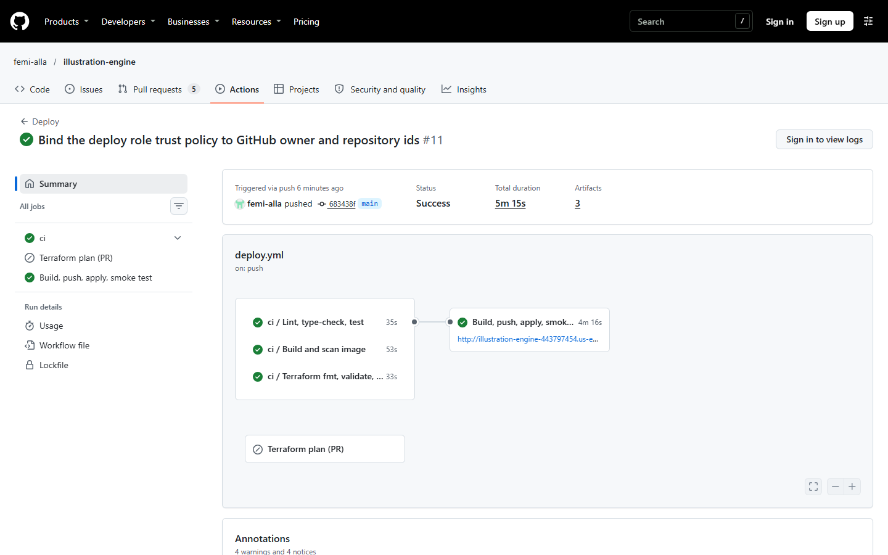

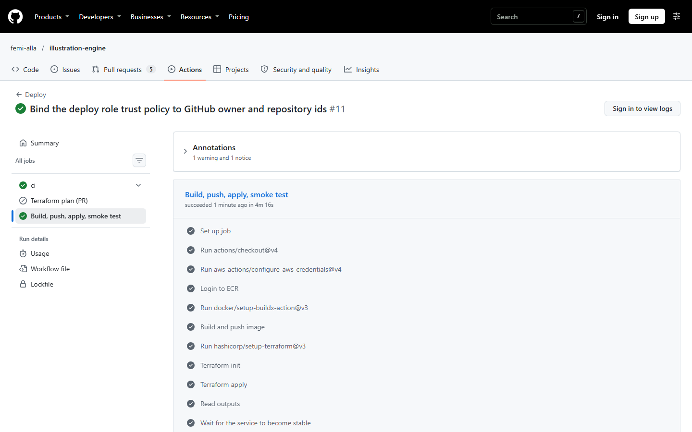

The Actions tab for `main`, with CI, CodeQL and Deploy all green on the deployed commit
(earlier red runs are the first-day fixes described in the git history: a stale
Trivy action tag, a pip-audit flag, two scanner findings and an OIDC subject format).

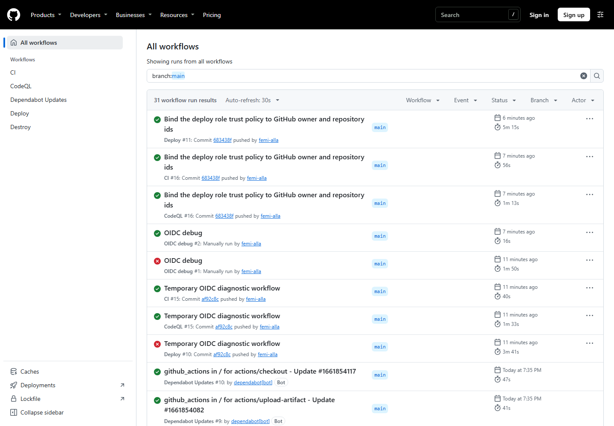

## 2. Pull requests get a Terraform plan

A pull request that touches `infra/live` or the deploy workflow gets a plan posted as a
comment, using the same OIDC role. Here on a Dependabot PR:

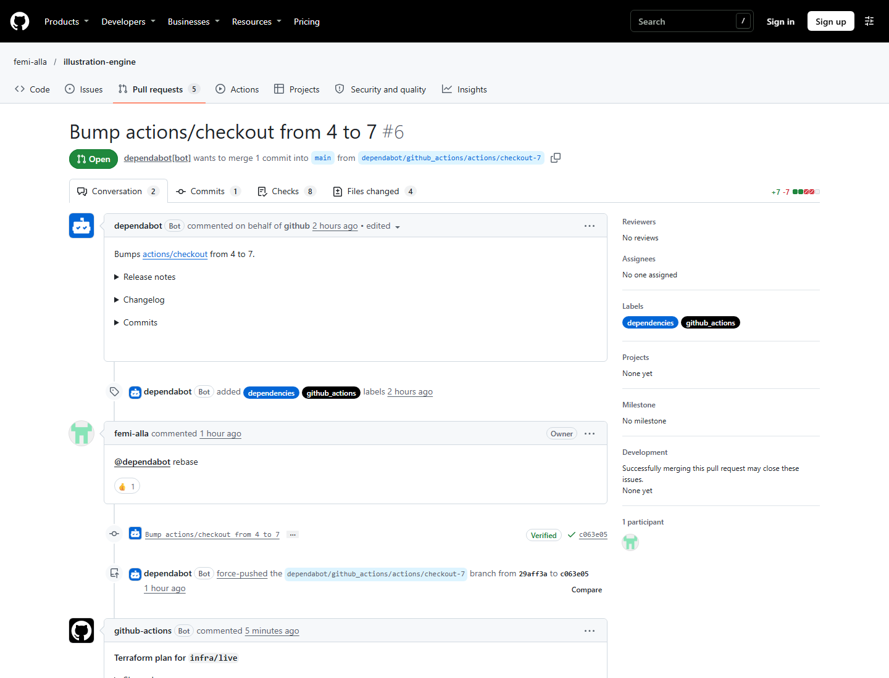

## 3. The service

The load balancer answered on plain HTTP at
`http://illustration-engine-443797454.us-east-2.elb.amazonaws.com`. `GET /version`
returned the deployed SHA, `GET /readyz` ran a real projection, and the OpenAPI page was
served from the container:

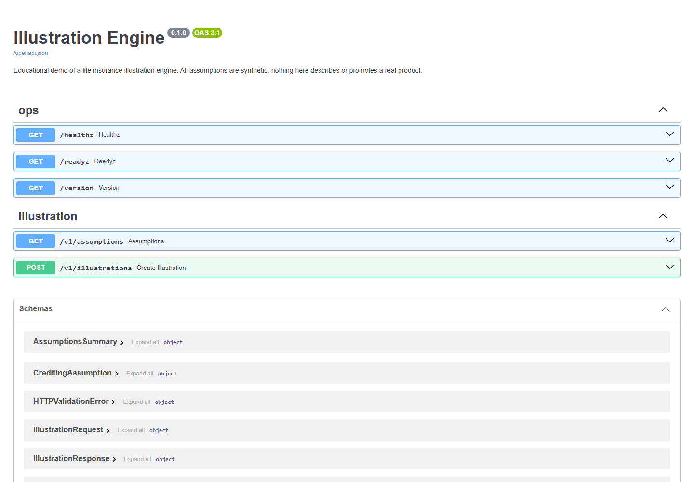

Verification from a workstation:

```text
$ curl -si http://illustration-engine-443797454.us-east-2.elb.amazonaws.com/version
HTTP/1.1 200 OK
x-request-id: 33f3e6d64f1840838a61e2c76387eaf2
{"version":"0.1.0","git_sha":"683438f3a100f24380b1d98347002f5cd8011fae","built_at":"2026-10-28T21:13:30-05:00"}

$ curl -s -X POST .../v1/illustrations -d @examples/fixed-level.json | jq '.scenarios.current.rows[-1]'
{ "policy_year": 30, "attained_age": 65, "account_value": 197413.66, "death_benefit": 356134.24, ... }
```

## 4. Observability under load

A five-minute mixed load test (858 requests: 736 valid illustrations and reads, 122
deliberately invalid bodies returning 422) was sent at the service. The dashboard
widgets below were rendered straight from CloudWatch with `GetMetricWidgetImage`.

| | |
|---|---|
| 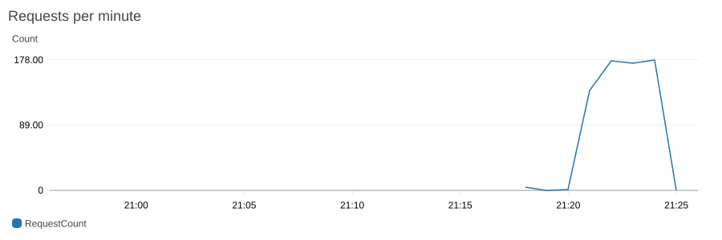 | 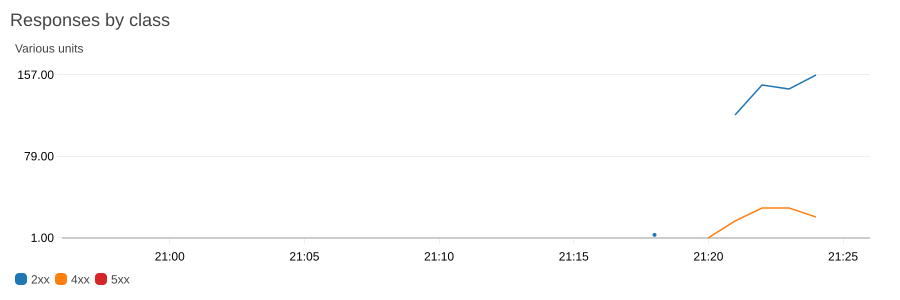 |
| 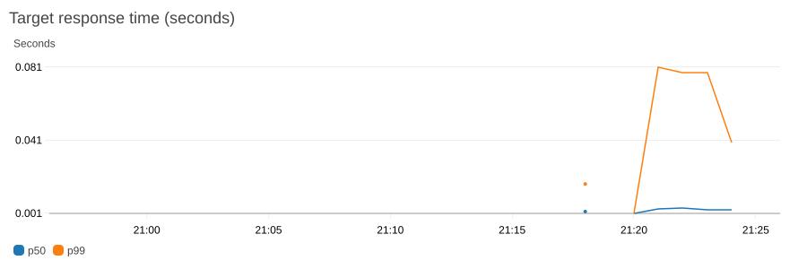 | 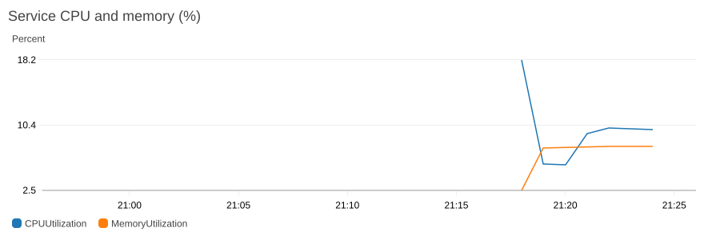 |

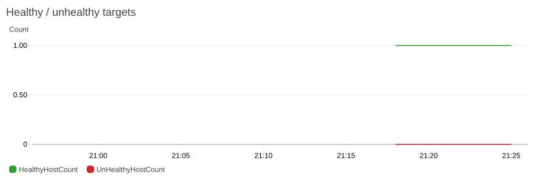

What the charts say: about 180 requests per minute on one 0.25 vCPU task, p50 latency
around 2 ms and p99 around 80 ms at the target, no 5xx, CPU around 10% and memory flat,
one healthy target throughout. The 4xx line is the deliberate validation failures.

All four alarms stayed in `OK`:

```text
illustration-engine-alb-5xx            OK
illustration-engine-ecs-cpu-high       OK
illustration-engine-latency-p99        OK
illustration-engine-unhealthy-hosts    OK
```

The structured request logs are queryable in Logs Insights. The dashboard's "slowest
requests" panel runs this query; the result during the load test is in
[`logs-insights.txt`](logs-insights.txt):

```text
fields @timestamp, method, route, status, duration_ms
| filter message = 'request'
| sort duration_ms desc
| limit 10
```

## 5. Teardown

The `Destroy` workflow (manual, requires typing `destroy`) ran `terraform destroy` on
the live stack through the same OIDC role, removing all 27 resources and leaving only
the bootstrap stack. Running cost of the live stack while it was up was about $1.50 per
day.

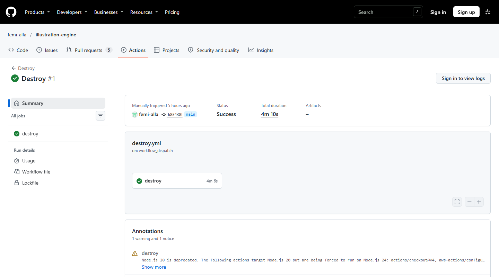

## Notes for anyone repeating this

- GitHub's OIDC subject claim now embeds owner and repository ids
  (`repo:owner@id/name@id:ref:...`). A trust policy written for the older
  `repo:owner/name:ref:...` form fails with a bare "Not authorized to perform
  sts:AssumeRoleWithWebIdentity". The bootstrap stack takes both ids as variables.
- Image scanners flag the pip and setuptools bundled in `python:*-slim`; the runtime
  image removes both, which is good practice regardless.
